# Research on Multi-energy Microgrid Double-Level Scheduling Based on Multi-Timescale Rolling Optimization (Matlab Code Implementation)

Includes complete Matlab code + data + detailed article
Article download link: Research on Multi-Timescale Rolling Optimization for Multi-Energy Microgrid Dual-Level Scheduling
Continuous environmental degradation and energy consumption necessitate the comprehensive utilization of various forms of energy. Therefore, multi-energy systems (MES) have received significant attention due to their ability to enhance overall energy efficiency and contribute to system economic and environmental benefits [1,2]. On one hand, MES can alter the supply and demand of energy carriers and networks, as well as manage the uncertain and unstable power generation output from renewable energy sources (RES) [3,4]. Moreover, due to the complementarity of energy, MES possesses unexplored potential in jointly minimizing operational costs, improving overall operational efficiency, and enhancing system flexibility.
Based on the advantages of multi-energy integration, this paper establishes a two-tier, two-level framework based on transaction control to achieve optimal energy supply among interconnected multi-energy systems (MES). At a lower level, each MES autonomously determines its optimal setpoint for controlled assets by solving the cost minimization problem, employing rolling horizon optimization to handle the stochastic characteristics of load and renewable energy. Further, a technique is realized to relax complementary constraints through storage, achieving convexity in the optimization model, with mathematical proof verifying the correctness of relaxation. At the upper level, the coordinator is responsible for minimizing the total cost of interconnected MES while preventing transformer overload.This collaborative issue is iteratively resolved within a proposed two-phase transaction control framework. This framework is compatible with the operational time requirements. At the same time, preserve the scalability of each MES. Information privacy and operational permissions were validated through simulation cases of detailed analysis of the collaborative autonomous optimization mechanism, proving the effectiveness of the proposed framework.
📚2 Operational Results
2.1 Case Study II: Purchased Electricity and Clearing Power Prices for Each MES in Three Modes
Original Figure:
Reproduced Figure:
Editor
2.2 Local Load and Renewable Energy (RES) Curves in Each MES
Original Figure:
Reproduced Figure:
Editor
2.3 Results of Electric Power and Thermal Power for Each Mes (a)
Original Figure:
Reproduced Figure:
Editor
2.4 Transformer Power in Three Modes
Original Figure:
Reproduced Figure:
Editor
2.5 Restrained Power and EES Power in MES with Rich Wind Resources
Original Figure:
Reproduced Figure:
Editor
Two issues will be discussed in this section. First, the impact of power losses on the simulationoutcomes. Second, the possibility of real-time coordination of the IMESs with the proposed 2S-TC framework. In this paper, power losses that include the loss in the connecting line and the transformer are not considered for simplicity , which may have impacts on the local accommodation of RES. As for the collaborative autonomous mode with feed-in limitation, the loss actually has no impact on the RES accommodation, since a 100% Accommodation is already guaranteed. Nevertheless, in the collaborative autonomous mode, when the transformer's export power is within the feed-in limit, the incorporation of power loss would incentivize the local electricity usage and increase the RES accommodation. However, compared with TC that lowers local price to incentivize electricity usage when the exportation congestion occurs, the impact of power loss on accommodation rate is limited and not the focus of this benchmark.2.5 Conclusion
This paper proposes a two-stage TC framework for coordinating multiple interconnected MESs. Due to the nonlinearity of the storage's complementarity constraint, a convexification technique is proposed along with two sufficient conditions to relax the constraint so that the convex problem applies to the distributed TC framework. In the proposed framework, each MES conducts rolling optimization autonomously at the lower level to minimize the operation cost under the given electricity price. At the same time, the upper-level system coordinator is responsible for updating the broadcasted price to solve the collaborative optimization iteratively . Considering the communication overhead and latency , a two-stage TC is established so that it even applies to real-time optimization with a short control interval, e.g., 5 min. Compared with SG-RTC, the simulation shows that the proposed 2S-TC obtains results with an error of less than 1% within ten times fewer iterations. It is also verified that the collaborative optimization helps to achieve a 100% local accommodation of RES, compared to the autonomous case. Furthermore, the benefits of different components in the MES and the effectiveness of the proposed convexification technique are also discussed in the simulation results. Future work will include the analysis of establishing a competitive gas market. Another possible research direction is to consider price-responsive loads in our model to exploit the flexibility of end-customers.🌈3 MatlabCode+Data+Detailed explanation  
🎉4 References

## Images

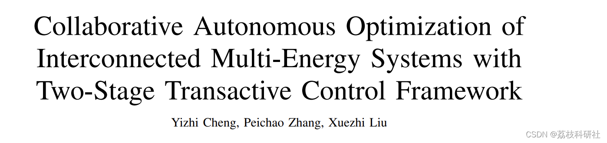
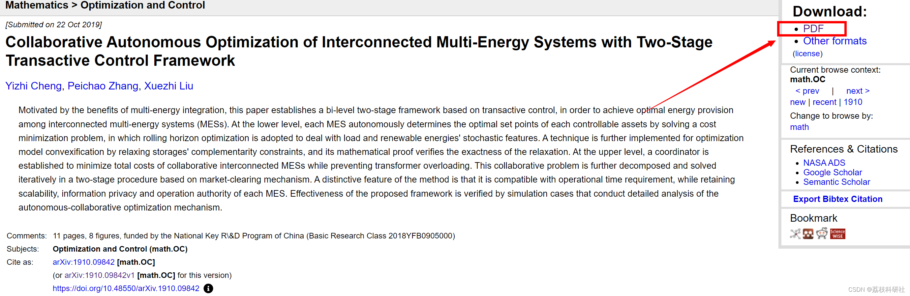
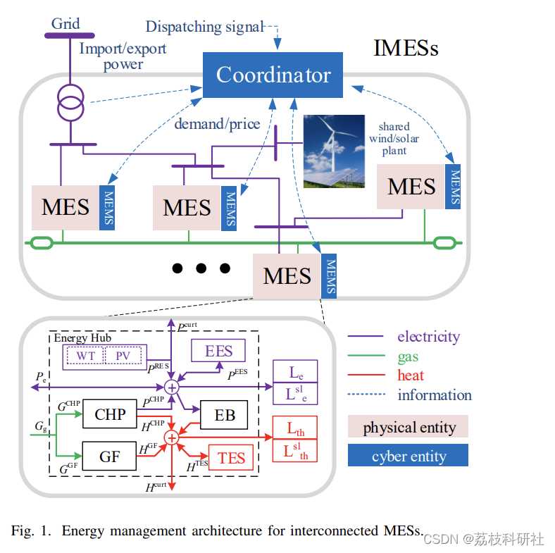
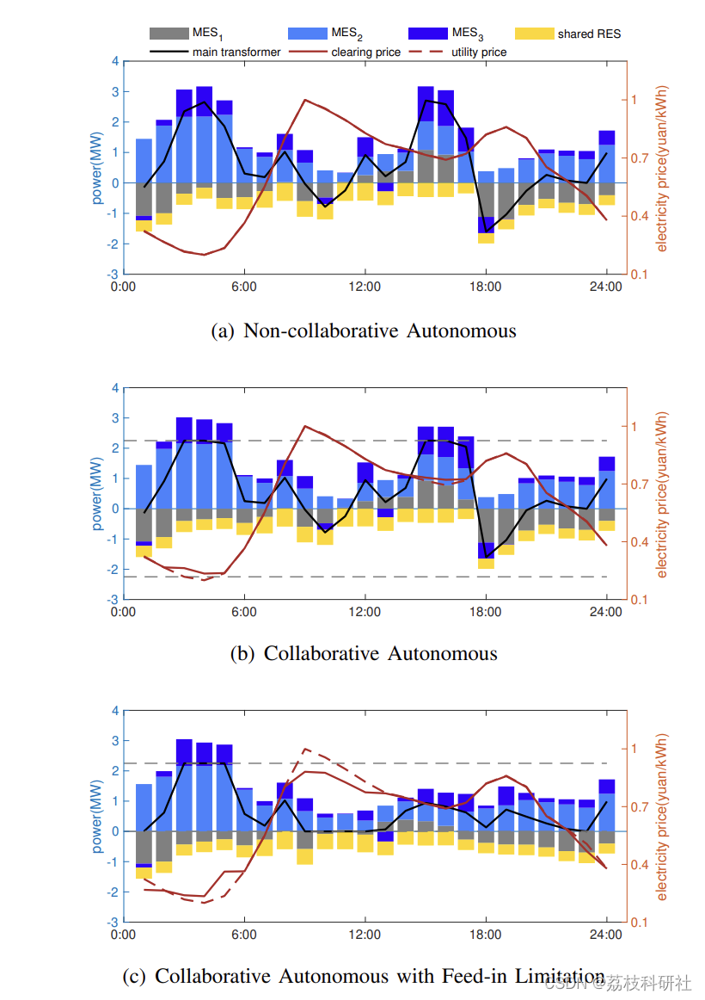
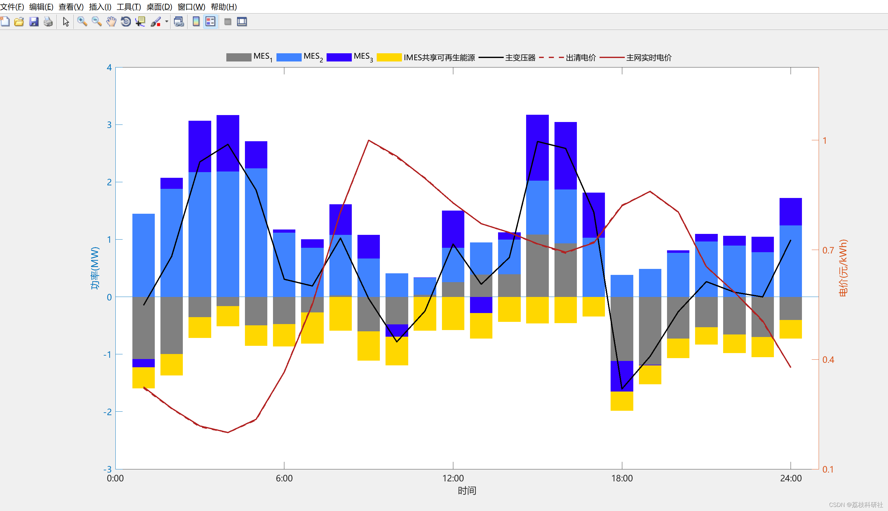
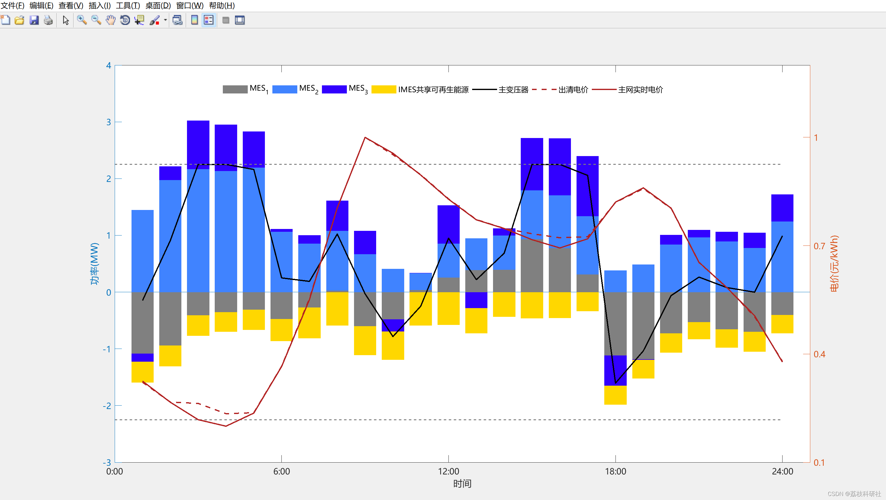
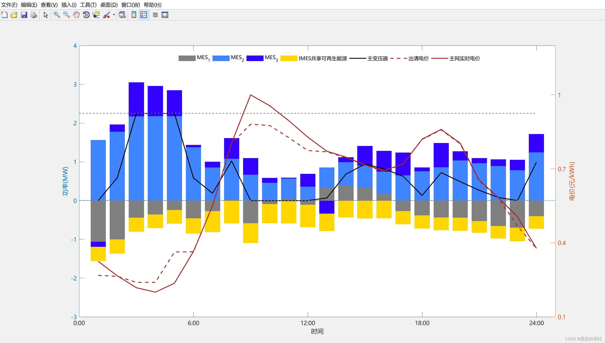
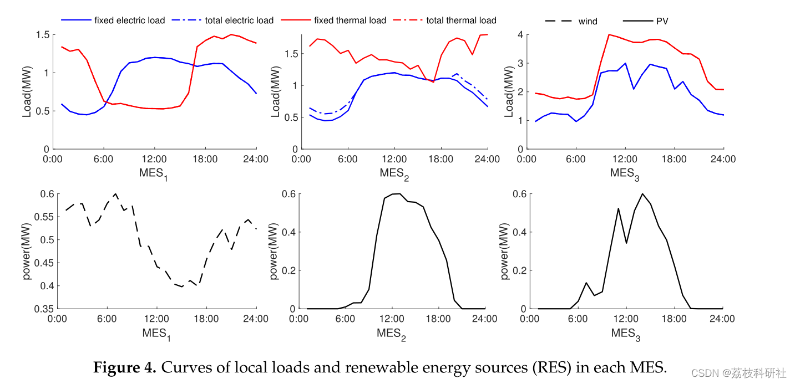
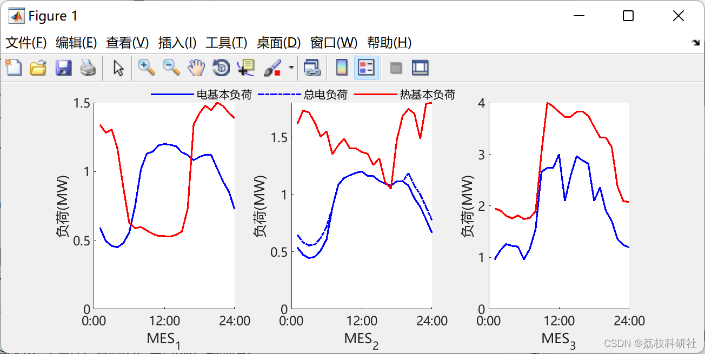
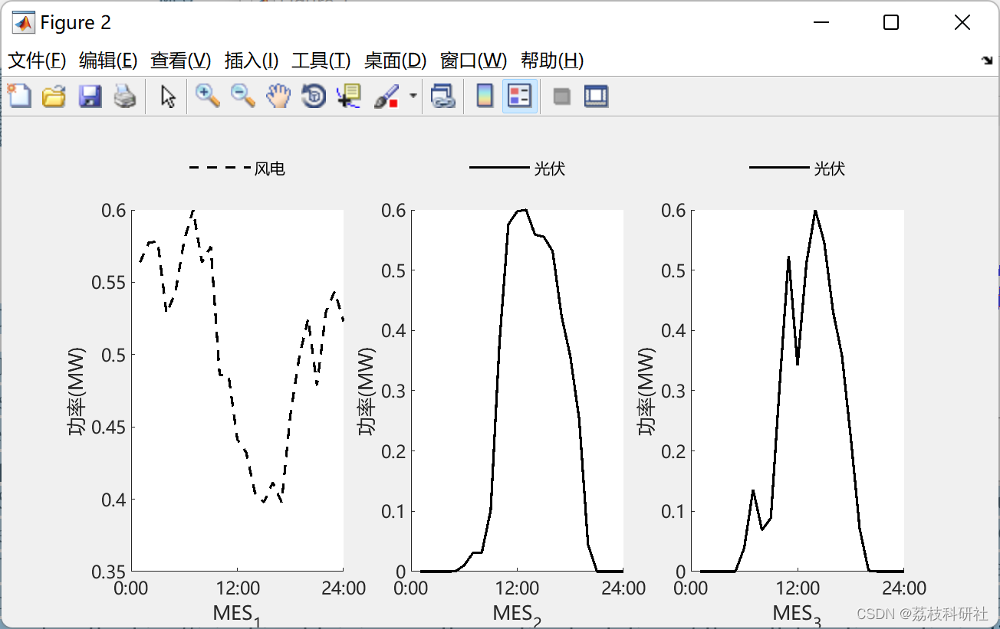
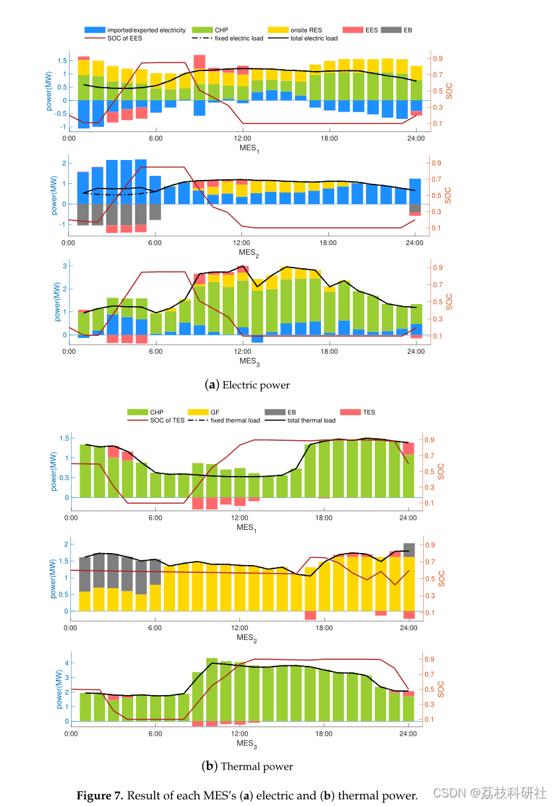
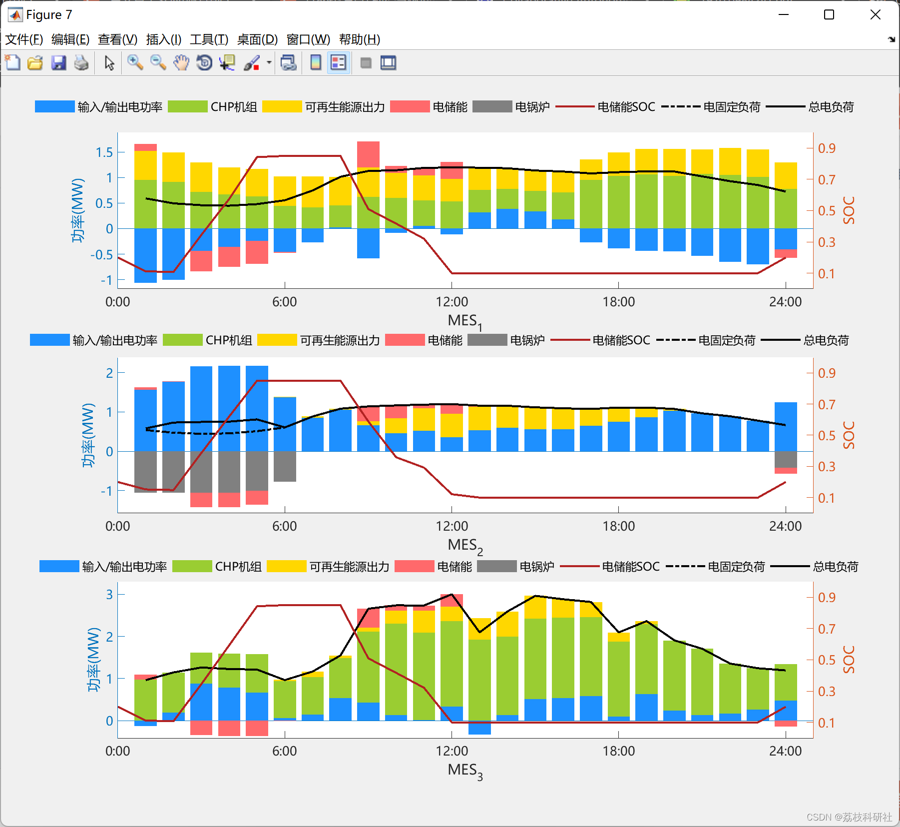
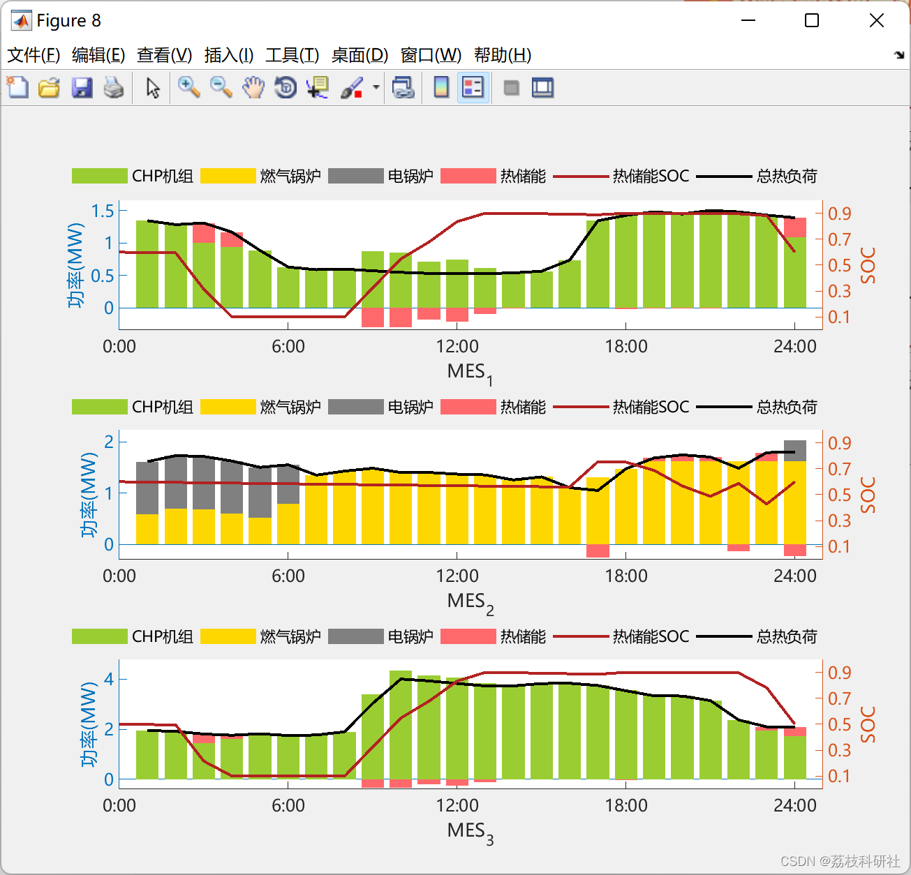
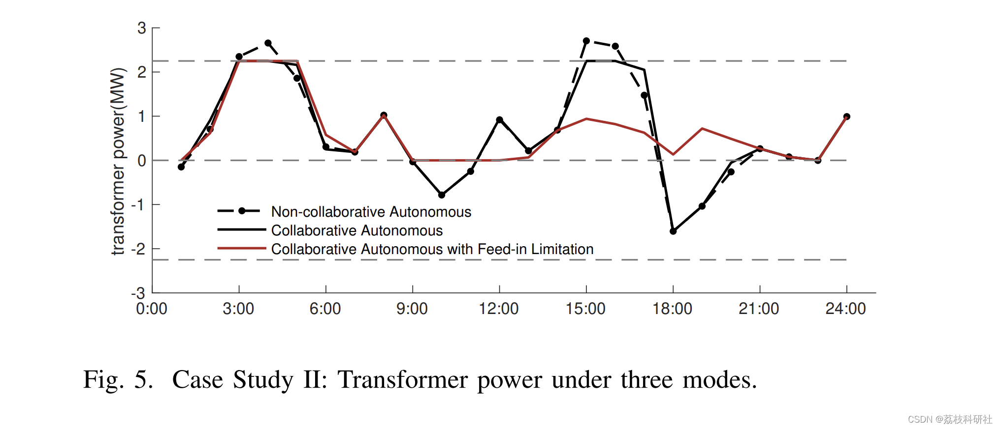
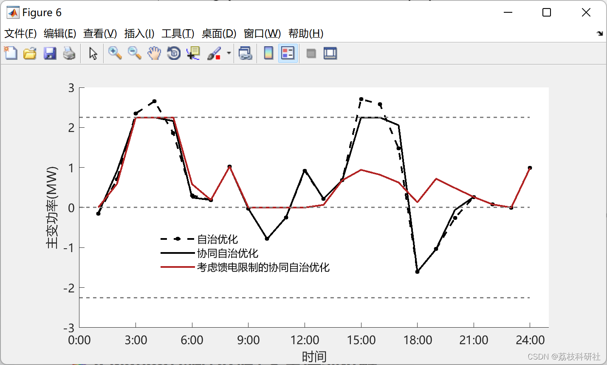
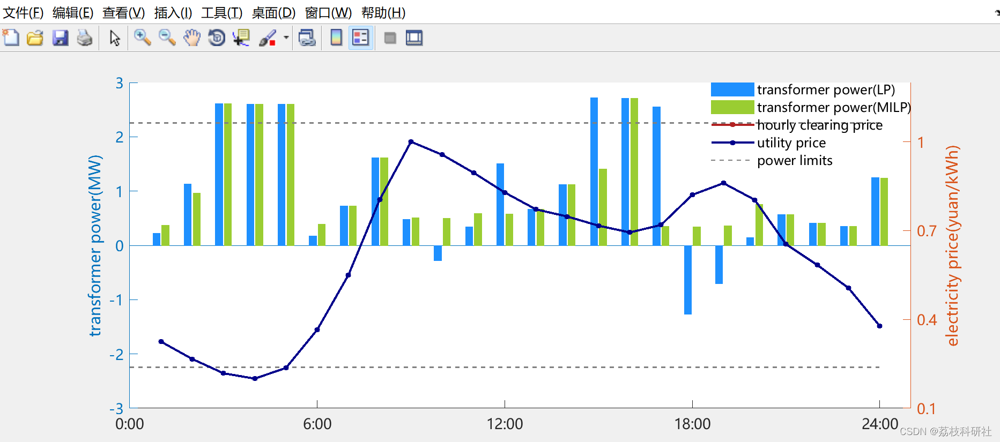
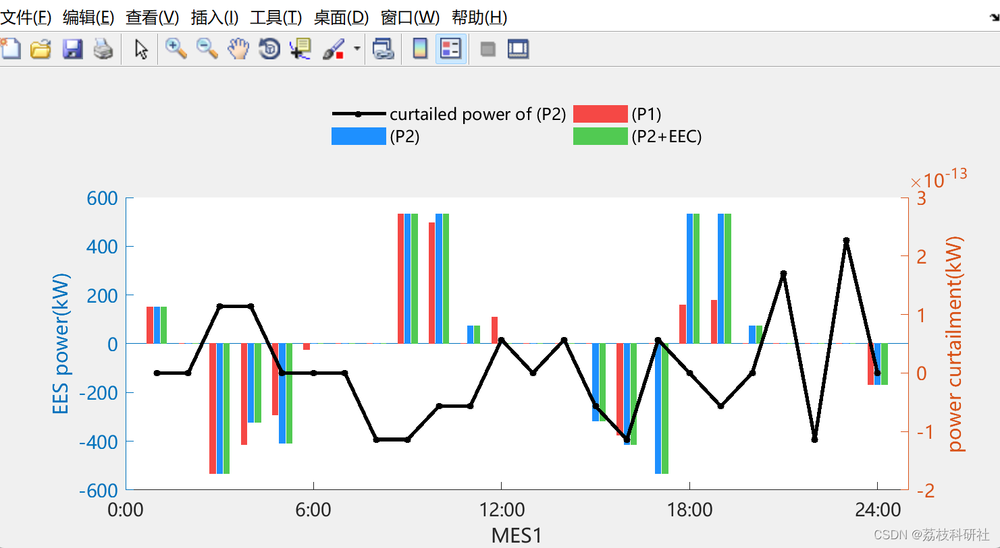
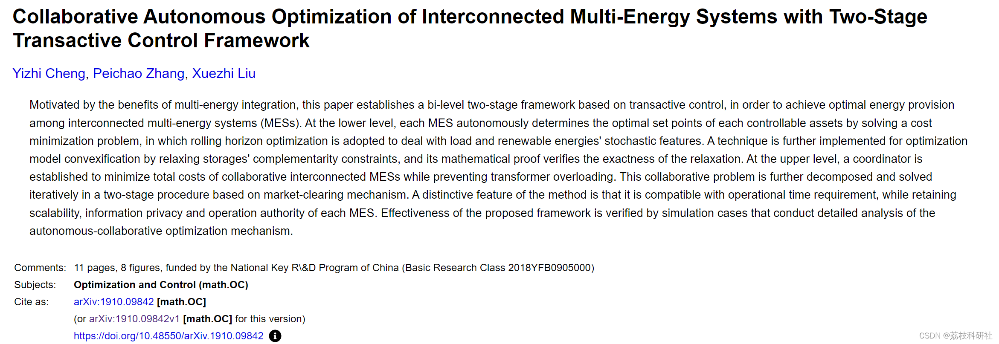

<!-- PAYMENT_BLOCK -->

## Get this dataset

- Payment link (Stripe): [Buy now](https://buy.stripe.com/3cs8yP7sY87d0vu9AB)
- Payment QR code: 

<!-- /PAYMENT_BLOCK -->
